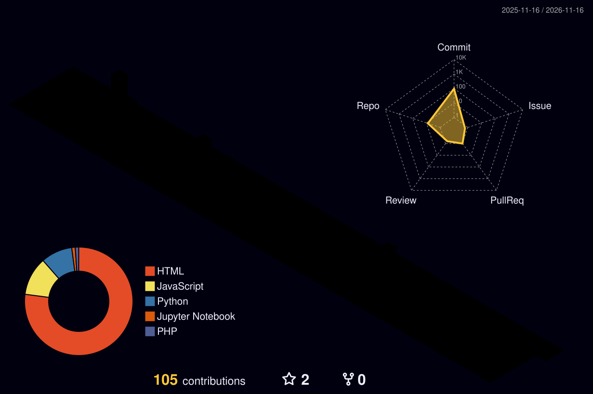

<!-- ========================= HEADER ========================= -->
<div align="center">


[](https://git.io/typing-svg)

[](https://raomitesh.in)
[](https://careerlens.in)
[](https://linkedin.com/in/raomitesh21)
[](https://www.kaggle.com/raomitesh)
[](mailto:raomitesh12@gmail.com)


</div>

---

## 👨‍💻 About Me

I'm a final-year **BSc IT (Data Science)** student at **JG University, Ahmedabad**, ranked **#1 in my stream**. I don't just study data science. I build products with it. I'm the founder of **[CareerLens](https://careerlens.in)**, an AI-powered resume skill-gap analyzer and career intelligence platform for Indian students and recruiters.


```python
class MiteshRao:
    def __init__(self):
        self.role = "Founder + Data Science Student"
        self.university = "JG University, Ahmedabad"
        self.cgpa = 8.83          # out of 10
        self.rank = 1             # in Data Science stream
        self.location = "Ahmedabad, Gujarat, India"
        self.open_to = ["Data Analyst", "Data Science", "ML Engineer (Intern/Entry)"]

    def what_i_do(self):
        return [
            "Build AI products that solve real problems",
            "Train and deploy machine learning models",
            "Create full-stack apps with React, Python and PHP",
        ]
```

### 🎯 Right Now

- 🚀 Growing **CareerLens**, helping students see which skills stand between them and the job they want
- 🤖 Building AI-powered apps and ML models
- 📚 Learning MLOps, Deep Learning (TensorFlow / PyTorch) and Cloud deployment
- 🤝 Open to internships and entry-level roles in **Data Analytics, Data Science and ML**
- 💬 Ask me about: Python, Machine Learning (XGBoost, Random Forest), SQL, React, WebSockets

---

## 🔥 Flagship Project

<div align="center">

### 🧭 [CareerLens](https://careerlens.in)
**AI Resume Skill-Gap Analyzer & Career Intelligence Platform**

*Built for Indian students and recruiters*

[](https://careerlens.in)

</div>

CareerLens reads a resume, compares it with what the target role actually demands, and shows the exact skill gaps, so students know what to learn next and recruiters can screen faster. It is a live product with its own domain, not a classroom demo.

---

## 🏆 More Projects

<table>
  <tr>
    <td width="50%" valign="top">

### 📊 [Profit Paradox](https://github.com/RaoMitesh21/Profit-Paradox-Intership-Project)
`Python` `XGBoost` `Random Forest` `Streamlit`

ML system built during my CS Vision internship. It predicts sales and profit patterns on 10K+ retail records with **R² above 0.85**, and includes a Streamlit dashboard for live predictions and customer segmentation.

  </td>
    <td width="50%" valign="top">

### 🌩️ [ThunderCast](https://github.com/RaoMitesh21/ThunderCast)
`Python` `Machine Learning` `Data Analysis`

AI model that predicts thunderstorms and gale-force wind speeds, built at the LJ University AI Hackathon for early-warning use cases.

  </td>
  </tr>
  <tr>
    <td width="50%" valign="top">

### 💬 [Talksy](https://github.com/RaoMitesh21/Talksy)
`React` `PHP` `WebSocket (Ratchet)` `MySQL`

Full-stack real-time chat platform with instant two-way messaging, a responsive React interface and a secure PHP-MySQL backend.

  </td>
    <td width="50%" valign="top">

### 🌐 [Portfolio Website](https://raomitesh.in)
`React` `HTML5` `CSS3` `JavaScript`

Responsive, animated personal site with a custom domain and SSL, showcasing my projects, skills and achievements.

  </td>
  </tr>
</table>

---

## 💼 Experience

### 🔬 Machine Learning Intern · CS Vision *(Remote)*
**Aug 2025 – Sep 2025**

- Built the **Profit Paradox** ML system on the Superstore dataset, reaching **85%+ R²** with XGBoost and Random Forest
- Built a customer segmentation pipeline that gave practical insights for discount optimization
- Developed an interactive **Streamlit** dashboard for real-time predictions and visualizations
- Ran full EDA and preprocessing on 10K+ records, beating the baseline model by 40%

---

## 🎓 Education & Achievements

| 🏅 | Details | Year |
|---|---|---|
| **Rank 1, Data Science stream** | BSc IT (Data Science), JG University · CGPA 8.83 / 10 | 2024 – 2027 |
| **Founder** | CareerLens, an AI career intelligence platform | 2025 – Present |
| **ML Intern** | CS Vision · Profit Paradox | 2025 |
| **Hackathon Participant** | LJ University AI Hackathon · ThunderCast | 2025 |
| **Certification** | Responsive Web Design · freeCodeCamp | 2025 |

---

## 🛠️ Tech Stack

<div align="center">

**Languages**


**Data Science & ML**


**Frontend**


**Backend & Database**


**Tools**


</div>

---

## 📊 By the Numbers

<div align="center">

<table>
  <tr>
    <td align="center" width="25%"><h2>8.83</h2><b>CGPA</b><br/>out of 10</td>
    <td align="center" width="25%"><h2>#1</h2><b>Rank</b><br/>Data Science stream</td>
    <td align="center" width="25%"><h2>85%+</h2><b>R² Score</b><br/>Profit Paradox ML model</td>
    <td align="center" width="25%"><h2>1</h2><b>Live Product</b><br/><a href="https://careerlens.in">CareerLens</a></td>
  </tr>
</table>

</div>

---

## 📈 GitHub Analytics

<div align="center">


<br/><br/>


<br/>


<br/>


<br/>


</div>

---

## 🌍 3D Contribution World

<div align="center">
  
</div>

---

## 🐍 Contribution Snake

<div align="center">
<picture>
  <source media="(prefers-color-scheme: dark)" srcset="https://raw.githubusercontent.com/RaoMitesh21/RaoMitesh21/output/github-snake-dark.svg" />
  <source media="(prefers-color-scheme: light)" srcset="https://raw.githubusercontent.com/RaoMitesh21/RaoMitesh21/output/github-snake.svg" />
  
</picture>
</div>

---

## 🎯 Goals for 2027

```python
goals_2027 = {
    "learning": [
        "Deep Learning and Neural Networks",
        "MLOps and production ML pipelines",
        "Cloud deployment (AWS / Azure)",
        "Next.js and advanced React patterns",
    ],
    "building": [
        "Take CareerLens to more students and recruiters",
        "Contribute to open-source AI/ML projects",
        "Portfolio v2.0 with richer animations",
    ],
    "career": [
        "Land a Data Science / ML role at a strong tech company",
        "Keep growing a public portfolio of real, shipped projects",
    ],
}
```

---

## 📫 Let's Connect

<div align="center">

If you're hiring, building something in AI/ML, or want to talk data, I'd love to hear from you.

[](https://raomitesh.in)
[](https://linkedin.com/in/raomitesh21)
[](mailto:raomitesh12@gmail.com)
[](https://www.kaggle.com/raomitesh)

*"Turning complex problems into elegant solutions, one line of code at a time."* 💻

</div>


